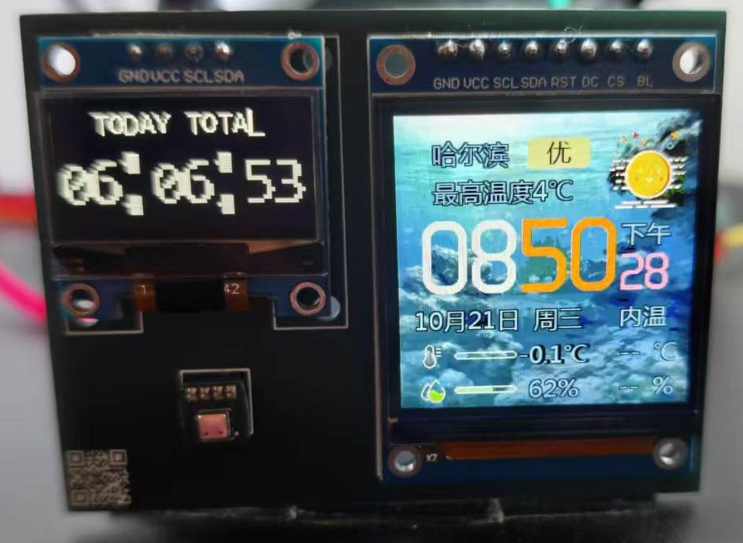
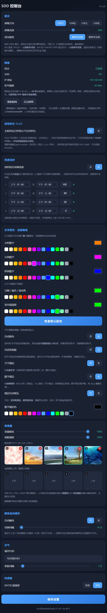
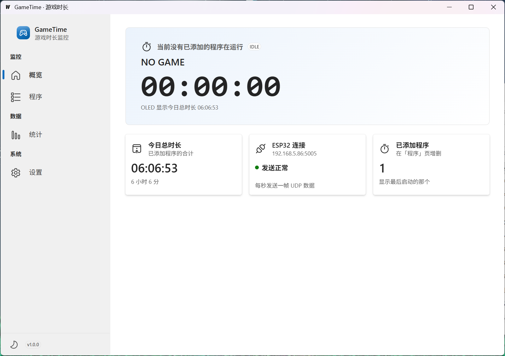
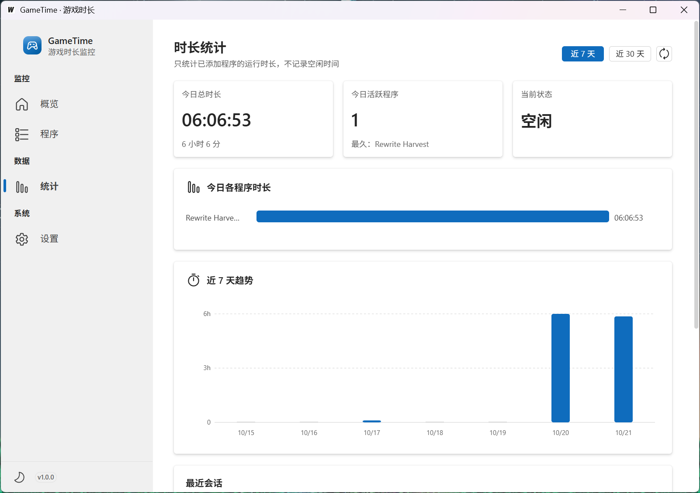
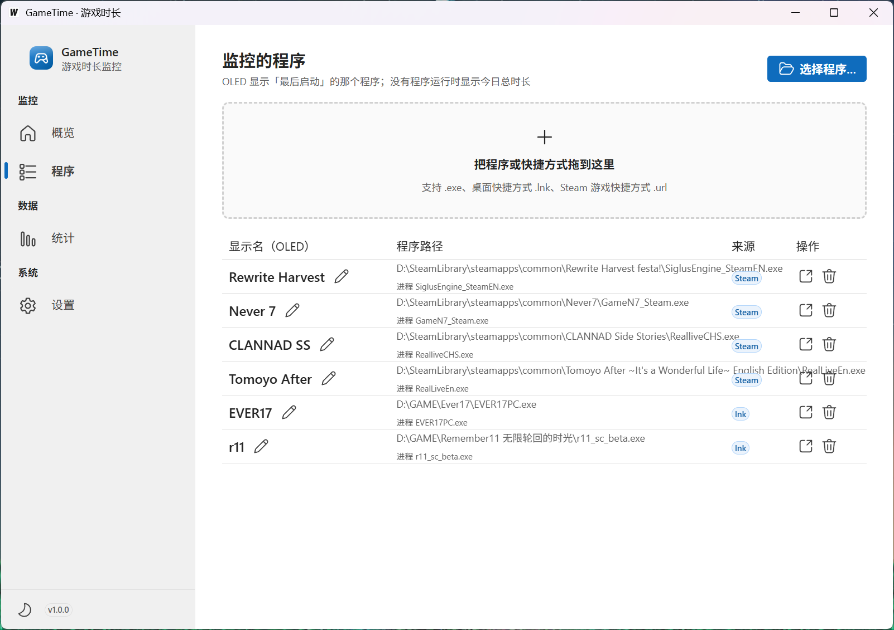
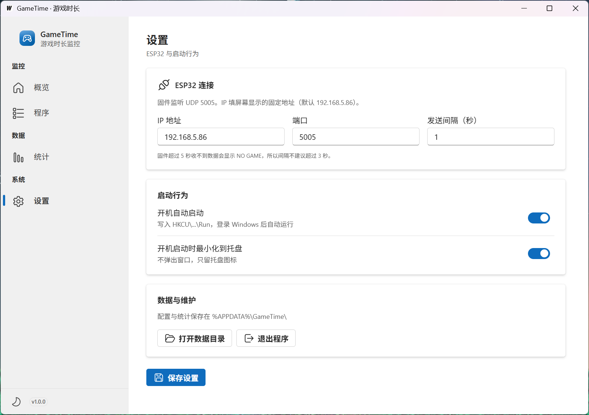
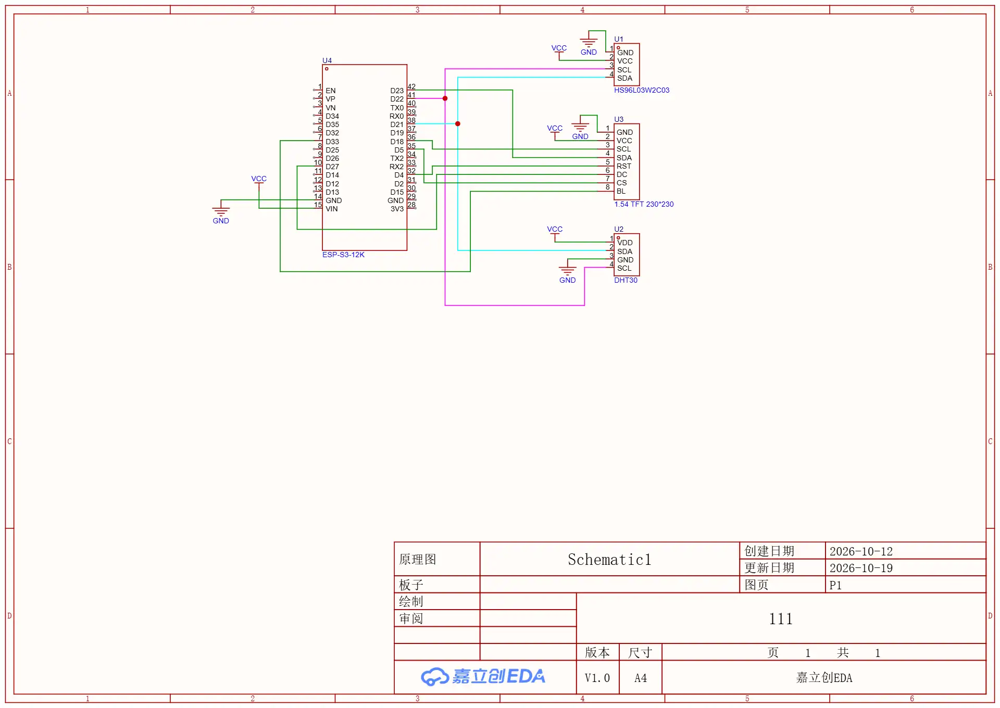

# ESP32 Clock · 天气时钟 & 游戏时长监视器

一块 **ESP32** 驱动的桌面小屏：右边是天气时钟，左边是电脑游戏/软件使用时长记录。
两个功能**可以单独使用，也可以组合使用** —— 只烧固件就是纯天气时钟，只跑 GameTime 就是纯时长统计工具。

<p align="center">
  
</p>

<p align="center">
  <a href="https://github.com/will86863/esp32-clock/releases"></a>
  
  
  
</p>

---

## 功能

### A. 天气时钟（ESP32 固件，独立可用）

- **时钟**：NTP 自动校时，12/24 小时制，时/分/秒三组颜色独立可调
- **天气**：实时天气 + 最高/最低温 + 空气质量，城市代码网页可改
- **室内温湿度**：I2C 数字温湿度传感器（DHT30/SHT30），自动识别两种协议
- **背景图**：最多 5 张，网页上传后浏览器端自动裁切压缩为 240×240，存入 SPIFFS
- **触摸切换**：TTP223 单击循环切换背景图
- **壁纸自动循环**：按设定间隔自动轮播，每张壁纸可保存独立配色预设
- **亮度调节**：背光 PWM 调光 + 按时段自动亮度（如白天 100%、夜间 20%）
- **文字配色**：取色器任选颜色；自动取色会随背景明暗自动反转保证可读性
- **描边**：矢量文字描边 + 时钟数字描边（2bpp 掩膜），可独立开关
- **Web 控制台**：浏览器访问 `http://sd3.local` 或固定 IP，全部设置图形化
- **断网自愈**：WiFi 断线按 1→2→4…→60 秒退避重连，**不清除已保存密码**

<p align="center">
  
</p>

### B. 游戏时长记录（GameTime 桌面程序，独立可用）

> **开箱即用**：下载 [`GameTime.exe`](https://github.com/will86863/esp32-clock/releases/latest/download/GameTime.exe)
> 双击就能跑，免安装、无需 ESP32、无需编译。

- **监控指定程序**：支持 `.exe` / `.lnk` / `.url`，可直接拖入窗口添加
- **「最后启动优先」**：同时添加多个程序，只显示最后启动的那个
- **Steam 识别**：拖入 Steam 快捷方式，自动解析 appid → 游戏名 → 安装目录 → 候选 exe
- **统计图表**：今日各程序横向柱状图、近 7/30 天趋势图、最近会话列表
- **托盘常驻**：关闭按钮 = 最小化到托盘，左键托盘图标唤出
- **开机自启**：可设置 `-minimized` 静默启动
- **单实例**：重复启动只会把已有窗口叫到前面

<p align="center">
  
  
</p>
<p align="center">
  
  
</p>

### C. 组合使用（推荐）

GameTime 每秒通过 UDP 把时长推给 ESP32，显示在右侧 0.96" OLED 上：

```
┌──────────────────┐      UDP 5005 / JSON      ┌──────────────────────┐
│   GameTime.exe   │ ────────────────────────► │      ESP32           │
│  (Windows 上位机) │        每秒一帧            │  TFT 天气时钟 + OLED  │
└──────────────────┘                            └──────────────────────┘
```

OLED 显示逻辑：有程序运行 → 显示程序名 + `HH:MM:SS`；无程序运行 → `TODAY TOTAL` 今日合计。

---

## 硬件

### 物料清单（BOM）

| # | 器件 | 型号 / 规格 | 数量 | 说明 |
|---|---|---|---|---|
| 1 | 主控 | **ESP32-WROOM-32 DevKit**（30 针，经典款 ESP32） | 1 | 非 S3/C3，需 4MB Flash |
| 2 | 主显示屏 | **1.54" TFT 240×240**（ST7789，SPI） | 1 | 时钟 / 天气 / 背景图 |
| 3 | 副显示屏 | **0.96" OLED 128×64**（SSD1306，I2C，地址 `0x3C`） | 1 | 游戏时长 |
| 4 | 温湿度传感器 | **DHT30 / SHT30**（I2C，地址 `0x44`） | 1 | 室内温湿度 |
| 5 | 触摸模块 | **TTP223**（数字输出） | 1 | 单击切换背景 |
| 6 | 杜邦线 | 母对母 / 公对母，若干 | — | 散件连接用 |
| 7 | 电源 | 5V / 1A 以上（USB 或外部 5V） | 1 | ⚠️ 见下方供电说明 |

> 📎 完整 BOM 与 PCB 工程文件见 [`docs/hardware/`](docs/hardware/)：
> `BOM.xlsx`（立创商城物料）、`espclock_2026-10-21.epro2`（嘉立创 EDA 工程，可自行打板）
>由于作者不会画PCB，所以目前只画了个充当转接的板子，如果有成品esp32模块可以打作者的PCB板或者直接杜邦线连接，可能有时间会学一下之后画个包含esp模块的板子，原理图也是

<p align="center">
  
</p>

### 接线表

#### 1. 主显示屏 TFT 240×240（ST7789，SPI）

| TFT 引脚 | ESP32 GPIO | 说明 |
|---|---|---|
| `VCC` | 3.3V | 供电 |
| `GND` | GND | 共地 |
| `SCL` / `SCK` | **18** | SPI 时钟 |
| `SDA` / `MOSI` | **23** | SPI 数据 |
| `CS` | **5** | 片选 |
| `DC` | **27** | 数据/命令 |
| `RST` | **4** | 复位 |
| `BL` | **33** | 背光，PWM 调光（高电平点亮） |

> ⚠️ **GPIO5 已被 TFT_CS 占用，不可他用**；GPIO 6–11 接内部 Flash，**绝对不可连接**。
> 部分模块无 `CS` 引脚（内置下拉）则可将 `CS` 接 GND。

#### 2. I2C 总线（OLED + 温湿度传感器共用）

| 器件 | 引脚 | ESP32 GPIO |
|---|---|---|
| 全部 I2C 器件 | `SDA` | **21** |
| 全部 I2C 器件 | `SCL` | **22** |
| 全部 I2C 器件 | `VCC` | 3.3V |
| 全部 I2C 器件 | `GND` | GND |

两个器件地址不同（OLED `0x3C`，DHT30 `0x44`），**可直接并联在同一条总线上**，无需额外上拉（模块自带）。
总线速率 400 kHz。

#### 3. 触摸模块 TTP223

| TTP223 | ESP32 | 说明 |
|---|---|---|
| `VCC` | 3.3V | |
| `GND` | GND | |
| `SIG` / `I/O` | **25** | 内部下拉，高电平有效 |

> TTP223 模块上的 `A` 焊盘**保持不焊**（出厂默认「直接输出」模式）。

#### 4. 电源

| 方案 | 接线 | 说明 |
|---|---|---|
| **推荐** | 外部 5V → `VIN`，GND 共地 | 打板/散件均可，供电最稳 |
| 简易 | USB 供电 | 仅单屏+传感器通常够用 |

> ⚠️ **重要**：TFT 背光全亮时电流较大。若出现**插 USB 就反复重启、屏幕闪**的现象，
> 说明 USB 供电电流不足（brownout 复位），**必须改用外部 5V 供电**后再插 USB 烧录。

#### 5. 不可使用的引脚

| GPIO | 原因 |
|---|---|
| 6 / 7 / 8 / 9 / 10 / 11 | 内部 SPI Flash，**绝对不可用** |
| 1 / 3 | UART0 串口（115200 调试输出） |
| 0 / 2 / 12 / 15 | Strapping 脚，影响启动模式，尽量避开 |
| 34 / 35 / 36 / 37 / 38 / 39 | 仅输入，无内部上下拉 |

---

## 快速开始

### 下载

| 需要什么 | 下载文件 | 说明 |
|---|---|---|
| **游戏时长软件**（Windows） | [**GameTime.exe**](https://github.com/will86863/esp32-clock/releases/latest/download/GameTime.exe) | 免安装单文件，12.7 MB，双击即用 |
| **固件**（只刷 app，推荐） | [firmware-SDD-V1.6.9.bin](https://github.com/will86863/esp32-clock/releases/latest/download/firmware-SDD-V1.6.9.bin) | 写入 `0x10000`，保留 WiFi/配置/背景图 |
| **固件**（完整镜像） | [firmware-SDD-V1.6.9-merged-4MB.bin](https://github.com/will86863/esp32-clock/releases/latest/download/firmware-SDD-V1.6.9-merged-4MB.bin) | 写入 `0x0`，适用于全新板 |
| 烧录脚本 | [flash.bat](https://github.com/will86863/esp32-clock/releases/latest/download/flash.bat) | Windows 一键烧录，免编译 |

全部版本：[Releases](https://github.com/will86863/esp32-clock/releases)

> **只想统计游戏时长？** 下载 `GameTime.exe` 直接跑，不需要 ESP32、不需要编译。


### 路径 A：只用天气时钟

**烧录固件**（二选一）：

- **免编译（推荐）**：下载 [`flash.bat`](https://github.com/will86863/esp32-clock/releases/latest/download/flash.bat) 与
  [`firmware-SDD-V1.6.9.bin`](https://github.com/will86863/esp32-clock/releases/latest/download/firmware-SDD-V1.6.9.bin) 放同一目录，双击 `flash.bat`，按提示输入串口号
- **从源码**：用 Arduino IDE 打开 `SmallDesktopDisplay/SmallDesktopDisplay.ino`，
  开发板选 **ESP32 Dev Module**，分区方案选 **Huge APP (3MB No OTA/1MB SPIFFS)**，然后上传

**首次启动**：

1. 按上方接线表连接 TFT + DHT30（OLED 可选）
2. 通电。首次开机自动开热点 `AutoConnectAP`（无密码），手机连上后选 WiFi、填密码
3. 屏幕显示 `http://sd3.local` 后，浏览器访问即可进入控制台

> ⚠️ 烧录时若报 `Wrong boot mode (0x17)`：按住 **BOOT** → 点一下 **RST** → 松 RST → 松 BOOT。
> 若插 USB 就反复重启，是供电不足，**先接外部 5V 电源**再烧。

### 路径 B：只用游戏时长统计

1. 到 [Releases](https://github.com/will86863/esp32-clock/releases/latest) 下载 **`GameTime.exe`**（单文件，无需安装）
2. 双击运行，常驻托盘
3. 「程序」页 → 点「选择程序…」或**直接把快捷方式拖进窗口**
4. 「统计」页查看今日/近 7 天/近 30 天使用时长

> 不接 ESP32 也完全可用 —— 它本身就是一个独立的程序使用时长统计工具。

**系统要求**：Windows 10 21H2+ / Windows 11（依赖系统自带 WebView2，两者均已预装）。
软件为免安装单文件，配置与统计数据存在 `%APPDATA%\GameTime\`，删除 exe 即可卸载。

### 路径 C：组合使用

1. 先完成路径 A，确认 ESP32 已联网（屏幕显示 IP）
2. 再完成路径 B
3. 在 GameTime「设置」页填 ESP32 的 IP（默认 `192.168.5.86`）和端口 `5005`
4. 保存后，OLED 即开始显示时长

---

## 编译

### 固件（ESP32）

| 依赖 | 版本 |
|---|---|
| ESP32 Arduino Core | **3.3.11** |
| TFT_eSPI | **2.5.43** |
| TJpg_Decoder | **1.1.0** |
| ArduinoJson | **7.4.3** |

```bash
arduino-cli compile \
  --fqbn "esp32:esp32:esp32:PartitionScheme=huge_app" \
  SmallDesktopDisplay
```

> ⚠️ TFT_eSPI 的引脚配置写在库目录的 `User_Setup.h` 里（非工程内）。
> 项目内的 `libraries/` 是**过期快照**，不参与编译，改它不会有任何效果。

### 上位机（GameTime）

> 普通用户**不需要编译** —— 直接下载 [Releases](https://github.com/will86863/esp32-clock/releases/latest)
> 里的 `GameTime.exe` 即可。以下仅为开发者说明。

需要 Go 1.21+ 与 [Wails v2](https://wails.io)：

```bash
cd GameTime
wails build -platform windows/amd64
# 产物：build/bin/GameTime.exe
```

运行时只依赖系统自带 **WebView2**（Win10 21H2+ / Win11 已预装）。

---

## UDP 协议

发往 `<esp32_ip>:5005`，UTF-8 JSON，每秒一帧：

```json
{"running":true,"name":"Rewrite+","up":18121,"today":18121}
{"running":false,"name":"","up":0,"today":19000}
```

| 字段 | 含义 | 固件行为 |
|---|---|---|
| `running` | 是否有程序在运行 | `true` 显示程序名 + 时长 |
| `name` | 显示名 | OLED 顶部居中，**纯英文 ≤16 字符** |
| `up` | 本次会话已运行秒数 | 大字 `HH:MM:SS` |
| `today` | 今日合计秒数 | 仅在 `running:false` 时显示 `TODAY TOTAL` |

固件侧约束：`char gameName[24]` → ≤23 字节；`(128-len*8)/2` 居中不截断 → 可见 ≤16 字符；
`GAME_TIMEOUT_MS=5000` → 5 秒收不到数据即视为未运行。GameTime 界面会实时校验显示名。

---

## 目录结构

```
esp32-clock/
├─ SmallDesktopDisplay/          ESP32 固件（Arduino sketch）
│  ├─ SmallDesktopDisplay.ino      主程序（约 4600 行）
│  ├─ number.cpp/.h                时钟数字绘制
│  ├─ weathernum.cpp/.h            天气数字绘制
│  ├─ oled.h / font8x16.h          OLED 驱动与字库（无外部依赖）
│  ├─ qr.h                         配网二维码
│  ├─ font/                        字体头文件（含自定义 vlw 字库）
│  └─ ESP32_ST7789_240x240_说明.md  详细硬件与固件说明
│
├─ GameTime/                     Windows 上位机（Go + Wails v2 + React）
│  ├─ main.go                      启动、命令行、资源嵌入
│  ├─ app.go                       暴露给前端的 API
│  ├─ monitor.go                   监控主循环（进程 → 会话 → UDP）
│  ├─ protocol.go / session.go     UDP 载荷、最后启动优先逻辑
│  ├─ winproc.go / steam.go        进程枚举、Steam 库解析
│  ├─ shortcut.go / icon.go        .lnk 解析、图标提取
│  ├─ stats.go                     会话统计（JSONL）
│  ├─ tray.go / autostart.go       托盘、开机自启
│  ├─ frontend/                    React 18 + Fluent UI v9 + Vite
│  ├─ assets/                      图标资源
│  └─ build/bin/GameTime.exe       编译产物（发布版见 Releases）
│
├─ docs/
│  ├─ hardware/                   BOM、PCB 工程、原理图
│  └─ img/                        README 截图
│
└─ tools/                        数字掩码生成与校验脚本（Python）
```

---

## FAQ

<details>
<summary><b>网页控制台打不开怎么办？</b></summary>

1. 先确认 ESP32 已联网：屏幕右上角无红色「无网络」角标
2. 用 IP 访问而非 mDNS：`http://192.168.5.86`（固定 IP）或查路由器分配的地址
3. 断电重启 ESP32，等 10 秒后再试
4. 仍不行则串口 115200 看日志，或进配网门户重新配网

> 已修复：V1.6.8 存在「开机 8 秒内未连上 WiFi 则 HTTP 服务永不启动」的缺陷，V1.6.9 已彻底修复。
</details>

<details>
<summary><b>屏幕黑屏 / 不亮？</b></summary>

1. 检查 `BL`（背光）是否接到 GPIO33，且为**高电平点亮**
2. 若是 PWM 调光，网页里把亮度调到 100%
3. 串口发送字母 `p` 可切换背光极性（排查接反的情况）
4. 确认供电充足 —— USB 供电不足会导致反复重启
</details>

<details>
<summary><b>温湿度显示 <code>--</code>？</b></summary>

说明传感器没读到数据。检查：

1. `VDD`/`GND` 是否接对，`SDA`→GPIO21、`SCL`→GPIO22
2. DHT20/DHT30 地址应为 `0x38`，SHT30 为 `0x44`（ADDR 接 GND）
3. I2C 上拉电阻（OLED 模块自带的通常够用）
</details>

<details>
<summary><b>烧录时提示 Wrong boot mode (0x17)？</b></summary>

芯片没进下载模式。按顺序操作：**按住 BOOT → 点一下 RST → 松开 RST → 再松开 BOOT**。

若插 USB 就反复重启（屏幕一直闪），是供电不足导致的 brownout 复位，**先接外部 5V 电源**再烧录。
</details>

<details>
<summary><b>OLED 显示 NO GAME？</b></summary>

GameTime 未运行、ESP32 IP 填错、或超过 5 秒没收到 UDP 数据。检查 GameTime「设置」页的 IP 与端口，
并确认电脑与 ESP32 在同一局域网。
</details>

---

## 致谢

- 原项目：**SmallDesktopDisplay**
- by **Misaka** **微车游**
- 此项目和GimeTime程序：
- by **will86863**
## License

MIT
